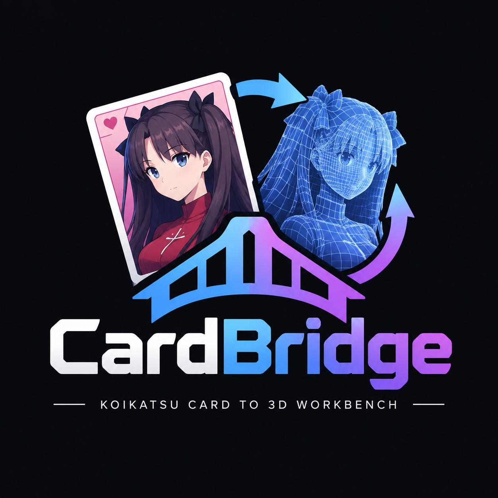
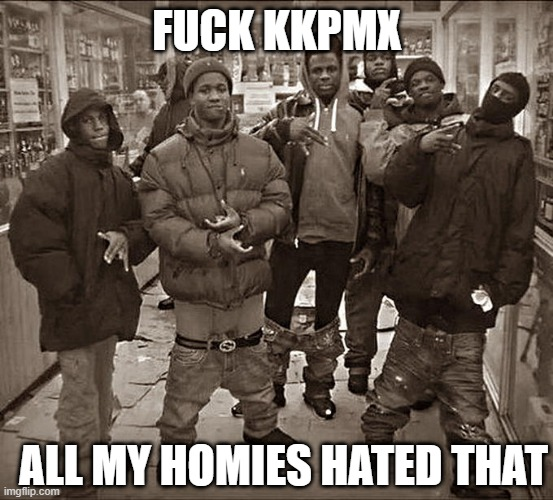
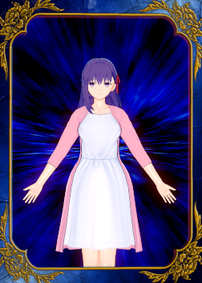
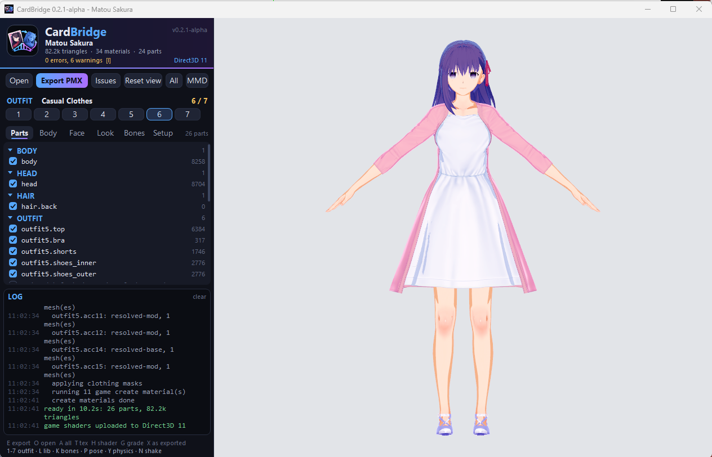
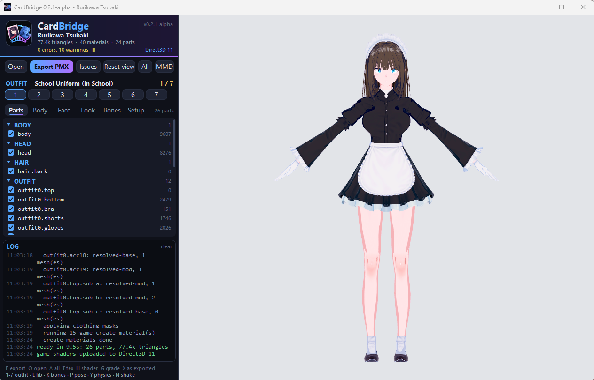
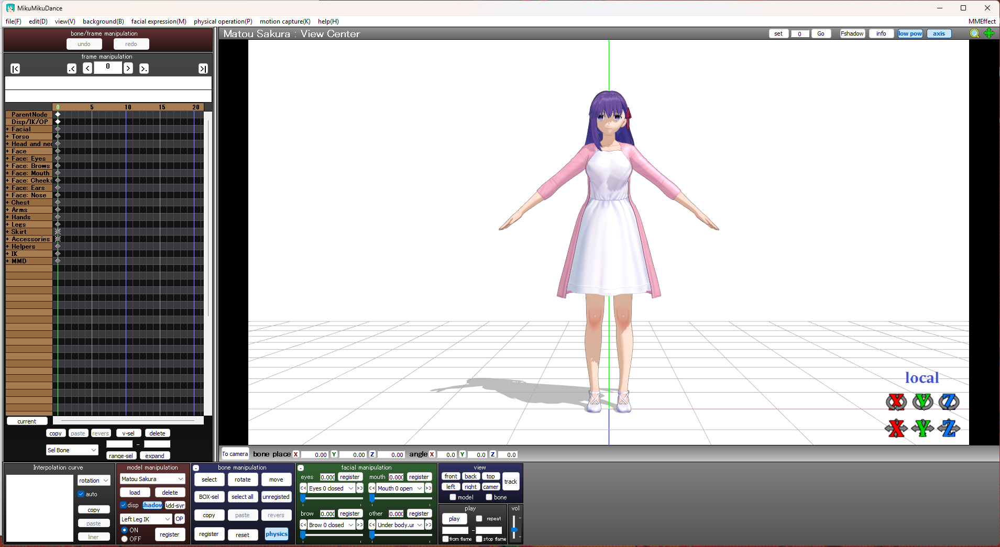
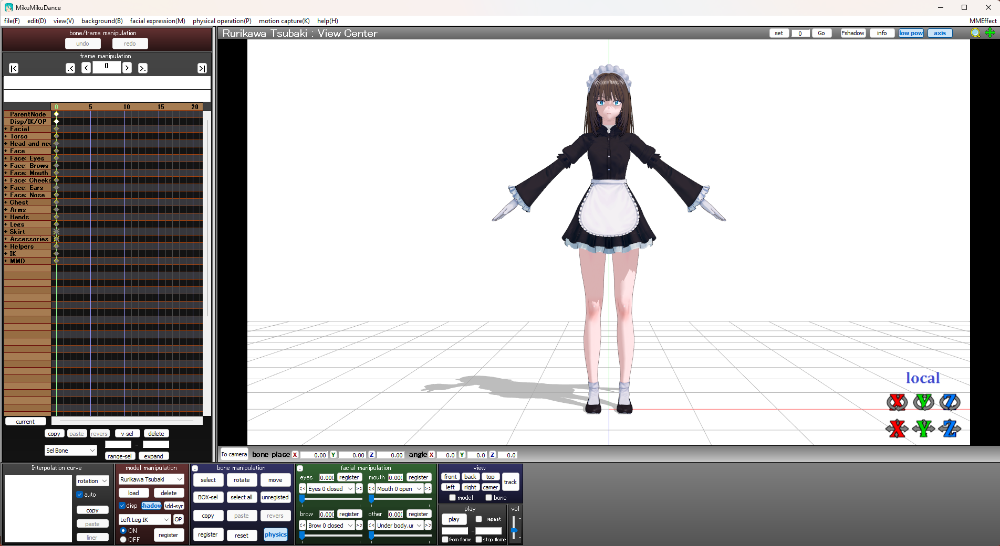

# CardBridge

<a href="LICENSE"></a>
[](https://hub.xerj.org/contributors/mobs3288)


<p align="center">
  
</p>

**CardBridge turns a Koikatsu character card into a rigged PMX model** — offline, on your own machine. The game does not need to be running, no plugin or BepInEx is involved, and nothing is uploaded anywhere. Drop a card onto the window, press `E`, and out comes a PMX with its textures, physics, morphs and a `.cardbridge.json` manifest — an alternative to KKPMX with a standalone workflow.

> **Version 0.7.8.** It converts **Koikatsu and Koikatsu Sunshine** cards with one offline pipeline. It works **100% for the base game**: stock items convert and look right. **Several modded cards also work**, but not all of them — expect rough edges and see [Known limitations](#known-limitations).
>
> **Starting 1 December 2026, development will slow down — but CardBridge is still in active development.** If you run into any issue, [open an issue](https://github.com/mobs3288/CardBridge/issues). That is the best way to get it looked at.

## Why it exists

Koikatsu's character maker is excellent at making anime characters — but the usual exporters run *inside* a launched game with a matching plugin set and break whenever anything drifts. CardBridge reads the same data from disk instead, so a conversion does not depend on a game process at all.

It started as a tool for my own game, Project K, because the character was the blocker: getting a finished, rigged, textured model out of Koikatsu without spending hours in a DCC tool. It is also for anyone who wants their own Koikatsu characters in MikuMikuDance or in another engine.

<p align="center">
  
</p>

*(Humour aside: KKPMX is MIT-licensed, documents useful PMX clean-up rules, and is a reference for this project. See [Prior art](#prior-art-and-licensing).)*

## Video demo

Converted models in MikuMikuDance:

<p align="center">
  <a href="https://youtu.be/z1WUHVzbCjQ" target="_blank" rel="noopener noreferrer">
    
  </a>
</p>

<p align="center">
  <em>Matou Sakura – Catch Catch | Koikatsu to MMD | CardBridge</em>
</p>

## Screenshots

**The inputs — character cards**

| Card 1 | Card 2 |
|---|---|
|  |  |

**CardBridge — the app**

<p align="center">
  <br>
  
</p>

**MikuMikuDance — the exported models**

<p align="center">
  <br>
  
</p>

## Install

**Windows 10 or 11, 64-bit.** The recommended download is the installer:

1. Download **[CardBridge-Setup-0.3.0.exe](https://github.com/mobs3288/CardBridge/releases/download/v0.3.0/CardBridge-Setup-0.3.0.exe)** (or browse **[all releases](https://github.com/mobs3288/CardBridge/releases)**).
2. Run it. Windows may warn that the publisher is unrecognised — see [Troubleshooting](#troubleshooting).
3. Choose the install directory (default: `Program Files\CardBridge`).
4. Pick the optional shortcuts (desktop) and finish.
5. Launch CardBridge from the Start Menu.

The installer creates the Start Menu shortcuts, registers CardBridge in **Add/Remove Programs**, and removes itself cleanly when you uninstall. Your settings, the asset library and your exports are **never** deleted by the uninstaller.

**Prefer not to install?** The portable package is the same build without the installer:
[CardBridge-Portable-0.3.0.zip](https://github.com/mobs3288/CardBridge/releases/download/v0.3.0/CardBridge-Portable-0.3.0.zip). Unzip it anywhere and run `CardBridge.exe` from the folder. Both distributions are built from the same binaries and behave identically.

### First run

The first time CardBridge starts it needs to know where your game data lives — one time only:

1. It asks for **your Koikatsu folder** (the one that contains `abdata`) and copies the data it needs into `%LOCALAPPDATA%\CardBridge\library` — about 0.9 GB for the full library (about 5 MB if you pick the minimal one), roughly 20 seconds, once.
2. It asks for your **mods folder** (or Cancel for base-game items only). CardBridge reads mods in place and never modifies them; mods are never shipped with it.
3. Drop a card `.png` on the window and press **E** (or *Export PMX*) to export.

**Settings** live in the **Setup** tab (library folder, mods folder, export defaults, graphics); keys `M` (mods folder) and `L` (library) work too. Everything is saved at once to `%LOCALAPPDATA%\CardBridge\viewer.json`.

## What you need

| Thing | What for | Notes |
|---|---|---|
| Windows 10 or 11, 64-bit | The app runs only on Windows | Windows 10/11 ship Direct3D 11 and the C++/GDI components the viewer uses |
| A GPU with Direct3D 11 | The 3D viewer (GPU-skinned) | Without a real GPU it uses WARP on the CPU; without D3D 11, a software renderer — same pictures, slower |
| Your Koikatsu (or Koikatsu Party) install | Copied into the CardBridge library, once | **Never needed at run time after that** |
| Your mods folder (optional) | `.zipmod` files (Sideloader mods) | Read in place, never changed. `.rar`/`.7z` mods must be unpacked first |
| A character card | The thing you convert | A `.png` made in the character maker |

Disk space: about 20 MB of application files plus the library (~0.9 GB full, ~5 MB minimal). In our own tests the converter peaked around ~350–430 MB of RAM (see [`docs/PERFORMANCE_REVIEW.md`](docs/PERFORMANCE_REVIEW.md)). Hardware requirements have not been formally profiled beyond that — the numbers above are from the machines the project was actually developed and tested on.

## Features

**Conversion and export**

- Reads Koikatsu character cards (`.png`) into a full part tree: body, head, hair, clothing, accessories
- Writes a self-contained export next to the PMX: PNG textures, and a `.cardbridge.json` manifest (part tree, stable IDs, per-part export toggles, material ranges, validation status)
- Preview baked into every export (`_preview.png`) — judge the result without opening the PMX
- Merged-physics export: DynamicBone chains (hair, skirts, ribbons) and bust soft-physics chains
- MMD-ready rig: Japanese MMD morph/bone names, A-pose rest pose by default, ground/self shadows
- Command-line interface: `cardbridge inspect|convert|clothes|library|simplify-bench|skin-bench`
- ~5× faster than early versions (see [`docs/PERFORMANCE_REVIEW.md`](docs/PERFORMANCE_REVIEW.md))

**Viewer and editing**

- Built-in 3D viewer (Direct3D 11, GPU-skinned; software fallback) showing exactly what the game's shaders draw
- Visibility controls: hover to highlight, click to hide/show, right-click to solo, group fold — hidden parts are dropped from the export entirely
- **Bones** tab: move/rotate/scale sliders with Shift-click exact entry, A-pose preset, undo/redo (`Ctrl+Z`/`Y`), pose save/load to JSON
- **Morphs** tab: the game's expression morphs as live 0–100 sliders, grouped like MMD's panels, with English aliases (MMD-standard names included)
- **Body measurements (BWH)**: Bust / Waist / Hip as real measurements in centimetres — typing an exact value solves the shape to it
- **Proportion correction** (opt-in, non-destructive): flags unusual values, offers half-way-to-neutral fixes, never touches your card. [`docs/PROPORTION_CORRECTION.md`](docs/PROPORTION_CORRECTION.md)
- **Material Workbench**: inspect and override mod materials live, with diagnostic viewport modes and an issues list
- **Optimize** tab: triangle reduction and stacked LOD files (`name_lod1.pmx` … `lod4.pmx`), per-part budgets that keep faces, eyes, hair and garments intact
- **Translucency brush**: hand-paint see-through regions onto garments; exports as a proper transparent material
- **Skin shading / Koikatsu AO bake**: cleavage shading and the game's own crease lines baked into the body skin ([`docs/KOIKATSU_AO_INVESTIGATION.md`](docs/KOIKATSU_AO_INVESTIGATION.md))

**Outfits and coordinates**

- Drag a Koikatsu **outfit file** (`【KoiKatuClothes】`) or a **Coordinate PNG** onto a loaded character: merge as clothing, replace as coordinate, or pick components one by one in the **Selective Import** window — three live views, nothing applied until you press Apply. The card on disk is never modified. [`docs/COORDINATE_IMPORT.md`](docs/COORDINATE_IMPORT.md)
- **Export clothes** (`Shift+E`): write an outfit file back out from a character card. [`docs/CLOTHING_EXPORT.md`](docs/CLOTHING_EXPORT.md)

**Experimental**

- **DynamicBone preview**: press `Y` for live physics in the viewer — hair and ribbons swing as they would in MMD. `N` gives them a shove
- **Face morph effects** (rendered on synthetic scenes so far, real-card verification pending): Eye Roll, Heart Eyes, Sweat — [`docs/FACE_MORPHS.md`](docs/FACE_MORPHS.md)

## How to use

### Viewer

1. Open CardBridge (Start Menu, or run `CardBridge.exe` with the card as argument, e.g. `CardBridge.exe "<card.png>"`).
2. Inspect the character — the Parts list shows Body, Head, Hair, Outfit, Accessories; the log panel shows every load/bake/export step.
3. Edit if you want (Parts visibility, Bones, Morphs, Look, Proportions, Optimize). Everything you see is what exports.
4. Press `E` (or **Export PMX**). Choose a folder, and CardBridge writes:
   `YourChar.pmx`, `textures/*.png`, `YourChar.cardbridge.json` (the manifest) and `_preview.png` (plus `_head.png` / `_feet.png` / `_shaded.png` depending on settings).

Hidden parts are dropped from the PMX entirely (and their bones with them); visible parts keep a `Hide <part>` morph so MMD can toggle them.

### Command line

```powershell
# once: copy the base-game data into your library (the ONLY command that reads the game)
cardbridge library import --game "<game folder>" --library "<library>"   # add --minimal for ~5 MB
cardbridge library check --library "<library>"

# look at a card without exporting
cardbridge inspect "<card.png>" --library "<library>" --mods "<mods>"

# convert
cardbridge convert "<card.png>" --library "<library>" --mods "<mods>" --out "<output folder>"

# inspect a PMX without a card, or verify a lossless import -> export round trip
cardbridge pmx info "<model.pmx>"
cardbridge pmx roundtrip "<model.pmx>" "<copy.pmx>"
```

Useful flags: `--clothes <outfit.png>` (apply an outfit/Coordinate file in memory), `--outfit N`, `--apose-degrees N` / `--tpose`, `--simplify 40`, `--lods`, `--skin-shade F`, `--skin-ao F`, `--pose <file>`, `--print-diagnostics`, `--normalize-*` for the opt-in proportion fixes. `cardbridge clothes` writes an outfit file back out from a card. Exit codes: `0` ok, `1` usage, `2` unsupported/rejected card, `3` conversion failed.

### Comparing the viewer view with the MMD output

`X` (or the **MMD** button next to *All*) switches to "as exported": the exact materials, toon ramps, edges, self-shadow and ground shadow the PMX has — what MikuMikuDance will actually show.

## Known limitations

**What works, honestly:** the base game, 100%. Several modded cards convert well too — especially Sideloader packs that ship their own textures — but no guarantee is made for any specific mod.

- **Mods:** only mods present on disk resolve; duplicates, and mods shipped as `.rar`/`.7z` (unpack first), are not handled. Some mods look right only with their MaterialEditor plugin data — main-texture replacements work, colour/float/shader overrides do not yet ([`docs/MATERIAL_EDITOR.md`](docs/MATERIAL_EDITOR.md))
- **Geometry:** clothing binds to the shared skeleton and the tool has no intuition about a mod's layout; items a mod ships with mismatched textures keep their prefab look. The tool warns when a garment hides body areas that were never modelled — it does not invent geometry
- **Bones & morphs:** every body/head rig transform becomes a bone (677 on the sample cards) and the face's blend shapes become morphs; the twist/helper bones and morphs the game's face has no pattern for are not exported
- **Face shape sliders are not applied yet** — the head keeps the default shape. Body sliders are applied
- **Export vs preview:** the preview runs the game's shaders with its own grading; the PMX carries the baked result through a toon ramp. It matches by construction, but it is still an approximation — judge exports with `X` ("as exported") and in MMD itself
- **Toggles:** PMX has no per-object visibility switch; outfit toggles are group morphs and ride on each viewer's behaviour; the manifest records the real toggles so engines do not depend on viewer behaviour
- **Plugins:** DynamicBoneEditor/HairAccessoryCustomizer/ABMX data is read and applied where the exporter understands it (see [`docs/COORDINATE_IMPORT.md`](docs/COORDINATE_IMPORT.md)); other plugin payloads are carried through untouched or skipped with a note in the issues list
- **Sunshine** (`【KoiKatuCharaSun】` / `【KoiKatuClothesSun】`) is recognised and reported as unsupported; **Koikatsu Party** cards are recognised but not verified end to end
- Not a guarantee: every export writes the source card, the library, the version and the author into the PMX header comment (shown in MMD's model info)

## Troubleshooting

- **"Windows protected your PC" / unrecognised publisher** — the installer is not code-signed, so SmartScreen warns. Click **More info** → **Run anyway**. The download's `.sha256` file lets you verify the file you got matches the release you meant to download (`Get-FileHash CardBridge-Setup-0.3.0.exe -Algorithm SHA256`)
- **Missing DLLs / won't start** — CardBridge ships nothing it does not need and links its C++ runtime statically; on Windows 10/11 it needs no extra downloads. If it fails to start anyway: update Windows, check the GPU driver (or force the software renderer in Setup → Graphics), and run `CardBridge-CLI.exe` to see the error on a console
- **First run is slow** — building the mod index takes about 15 minutes for ~4,000 mods; it is cached in `%LOCALAPPDATA%\CardBridge\modindex.json`, so later runs are fast
- **A mod item shows as missing** — it is not in your mods folder. The issues list names the mod GUID; drop the `.zipmod` in the folder, rebuild the index from the Setup tab, and reload
- **Card rejected as unsupported** — check the card family (`【KoiKatuChara】` is the target); Sunshine is not supported. If it should work, [open an issue](https://github.com/mobs3288/CardBridge/issues) with the log and the card's header bytes
- **The export looks different from the viewer** — press `X` ("as exported"): the PMX will look like what you see there, not like the Lit/game view
- **Export wrote nothing / nothing found** — check the export folder in the Setup tab, and the Issues tab for the reason
- **Still stuck** — [open an issue](https://github.com/mobs3288/CardBridge/issues) with: what you did, what you expected, what happened, your CardBridge version and GPU, and the log (the viewer's log panel, or the CLI's stderr output)

## FAQ

**Q: Is this vibecoding?**

> **A:** Yes.
>
> The vibes are immaculate. The vertices are under investigation.

**Q: Can you code?**

> **A:** Yes. I use AI coding tools extensively because they can implement things faster than I can write everything manually. I still make architectural decisions, review code, debug issues, and validate the results.

**Q: Then why not do it manually?**

> **A:** Because I'm too lazy to do everything manually, and Claude Opus 5.5 can often implement things faster than I can.
>
> Why spend hours writing code when I can spend those hours reviewing AI-generated code, debugging it, reverse-engineering Unity AssetBundles, and questioning every life decision that led me here?
>
> **Work smarter, not harder.** Or at least make the computer do the hard part.
>
> And yes, when I'm not using Claude — or the budget runs out — I'll do it myself.
> — Thanos

**Q: So the AI writes everything?**

> **A:** A substantial amount of the code is AI-generated. I'm not going to pretend otherwise.
>
> I direct the implementation, make architectural decisions, investigate problems, review changes, test the results, and decide what needs fixing. AI-generated code can be wrong, inefficient, or unnecessarily complicated.
>
> If something breaks, it's still my problem.
>
> **AI-assisted development. Human-operated suffering.**

**Q: Why build this instead of just using KKPMX?**

> **A:** KKPMX already exists and is useful. CardBridge is my attempt to build an alternative with a standalone workflow, extensible mod support, better diagnostics, and eventually an integrated editing experience.
>
> These are goals, not claims that CardBridge is already better. The conversion pipeline still needs substantial validation.
>
> The objective isn't to reinvent everything just for the sake of it. It's to build something that better fits my needs.
>
> *(The meme stays, though.)*

**Q: Why Koikatsu, though?**

> **A:** Because creating anime-style characters in Koikatsu is much more accessible than building them from scratch in general-purpose 3D software.
>
> Its character creator makes it easy to customise faces, hairstyles, clothing, body proportions, and other details without needing to model everything manually. Combined with its modding ecosystem, it offers a convenient way to create and customise anime characters.
>
> The problem is getting those characters out of the game and into an editable PMX model without spending hours fixing materials, hair, accessories, and other conversion issues.
>
> That's where CardBridge comes in: bridging the gap between Koikatsu's character creation workflow and the broader MMD/PMX ecosystem.
>
> And honestly, creating anime characters is fun. Reverse-engineering Unity AssetBundles to get them out is where the suffering begins. 💀

**Q: Is CardBridge production-ready?**

> **A:** No.
>
> Milestone 1, the headless proof of concept, is complete. However, successfully generating a PMX file doesn't mean the resulting model faithfully reproduces the original character.
>
> Colours can be wrong, hair can disappear or move, materials can break, and geometry or deformation can require further work.
>
> The feasibility study suggests the approach is viable. The complete conversion pipeline still needs to prove itself through testing.

**Q: Will it support every mod?**

> **A:** That's the goal, not a promise.
>
> Mods can introduce different assets, dependencies, material configurations, and structures. CardBridge aims to handle these through extensible asset resolution, clear diagnostics, and compatibility testing.
>
> If a mod breaks the converter, I'd rather know exactly why than silently export a broken model.

**Q: Why is the project called CardBridge?**

> **A:** It bridges the gap between a character card and an editable 3D model.
>
> Also, `CardToPMXButHopefullyItActuallyWorksAndEasyToUseWithoutAnyManualModification` was too long.

**Q: Why is the logo AI-generated?**

> **A:** Because my entire budget went to Claude, and I suck at design.
>
> I'm trying to reverse-engineer Unity AssetBundles and build a standalone PMX exporter, not become a graphic designer.
>
> **Priorities, people.** 💀

## Changelog and releases

- [CHANGELOG.md](CHANGELOG.md) — what changed, release by release
- [Releases](https://github.com/mobs3288/CardBridge/releases) — downloads and notes for each version
- [Issues](https://github.com/mobs3288/CardBridge/issues) — bug reports and feature requests (please open one if anything breaks)

## Prior art and licensing

| Tool | Role | License |
|---|---|---|
| KKPMX | Reference for PMX clean-up rules; it runs in the game, so it cannot be a dependency | MIT |
| KKBP exporter/importer | Reference for what a full export contains; in-game plugin | Not verified |
| KKManager | Reference for card-marker detection | GPL-3.0: read for format knowledge only, no code is copied |
| UnityPy | Used for research and golden reference data only; not shipped | MIT |
| AssetRipper | Not used; noted as a reference | GPL-3.0 |
| bc7decomp (Richard Geldreich, Jr.) | BC7 texture decoder, the only third-party code in the repository (`third_party/bc7decomp`, its notice kept in the file) | MIT or public domain |
| nlohmann/json, stb_image, stb_image_write, glm | Downloaded by CMake at build time, not in the repository; glm only for the engine cross-check test | MIT; MIT or public domain; MIT |
| BepInEx | The sidecar plugin builds against the game install's copy; not in the repository | LGPL-2.1 |

Format knowledge is re-implemented from observation and the decompiled assembly; no code from the reference tools above is copied. Game and mod assets are never committed to this repository.

CardBridge's own code is released under the MIT License (see [LICENSE](LICENSE)). The licence covers this repository's code only: the game's and mods' assets, and anything converted from them, belong to their owners and are not covered by it.

## Building from source

Windows, using the repository's portable toolchain (`tools/`):

```powershell
powershell -NoProfile -ExecutionPolicy Bypass -File .\build.ps1 -Test
```

Output goes to `build\bin` (`cardbridge.exe`, `cardbridge_viewer.exe`, `cardbridge_tests.exe`). `-Test` runs the unit tests (no game files needed); integration tests run when `CARDBRIDGE_TEST_LIBRARY` / `_MODS` / `_CARD` / `_GOLDEN` are set.

To build the release artifacts (the installer and the portable ZIP):

```powershell
.\installer\build_installer.ps1
```

See [`installer/README.md`](installer/README.md) for the Inno Setup requirement and the layout. Release asset names come from the `VERSION` file at the repository root — update it (and see [CHANGELOG.md](CHANGELOG.md)) every release.

To check a PMX for what MikuMikuDance chokes on (nested group morphs, IK limits, NaN, bad indices): `python tools/audit_pmx_for_mmd.py model.pmx`.

## Repository layout

```text
cardbridge/
  CMakeLists.txt      standalone project; also add_subdirectory()-able from the engine
  src/                core library: cards, bundles, resolver, assembler, PMX writer, export
  cli/                the command-line shell
  viewer/             the viewer window (Win32 + Direct3D 11)
  installer/          Inno Setup script, build_installer.ps1, branded wizard assets
  tests/              unit and golden tests
  tools/              Python reference (research only, not shipped), smoke tests
  docs/               design notes, investigations, per-feature documentation
  image/              README artwork (CB.png is the logo)
  VERSION             the one place the version number is written
```

## Milestones

- [x] **0.** Offline feasibility study (verdict: go)
- [x] **1.** Headless proof of concept: one real card to PMX, no game process (verified on two cards; open items in the feasibility doc, 12.4)
- [ ] **2.** Live preview and part tree on the engine renderer
- [ ] **3.** PMX part organisation, toggle testing, validation
- [ ] **4.** Standalone UI, project save/load
- [ ] **5.** Slot replacement and mod robustness
- [x] **6.** Packaging (installer + portable ZIP, reproducible build)

Milestone 1 acceptance tests (A1 to A10) are listed in the feasibility document.

---

<p align="center">
  <sub>Built with C++, reverse engineering, AI assistance, and a questionable amount of spite.</sub>
</p>
