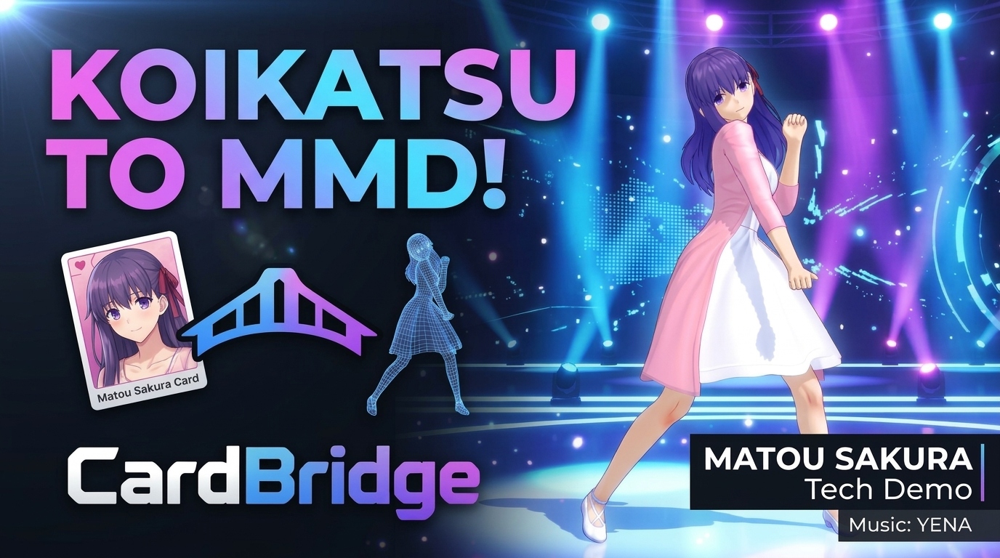
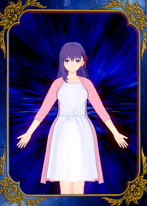
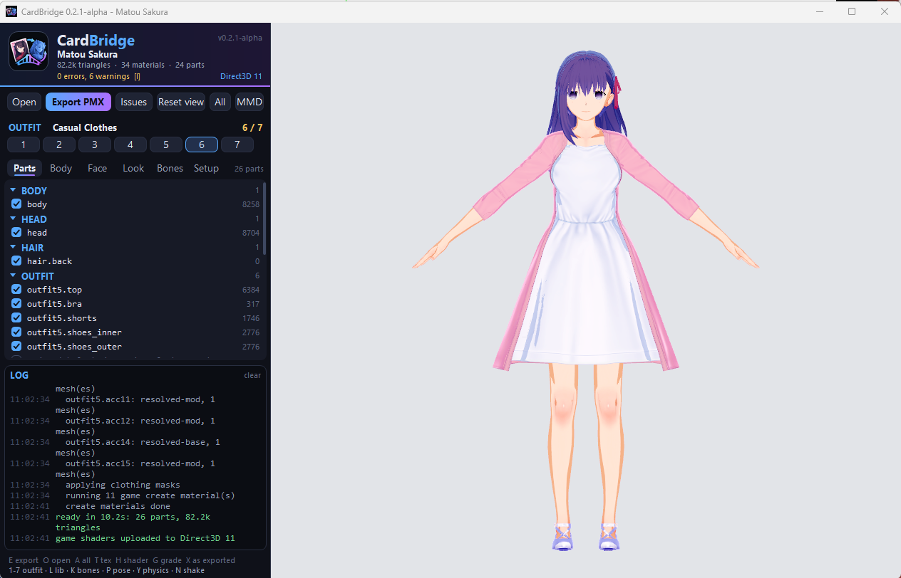
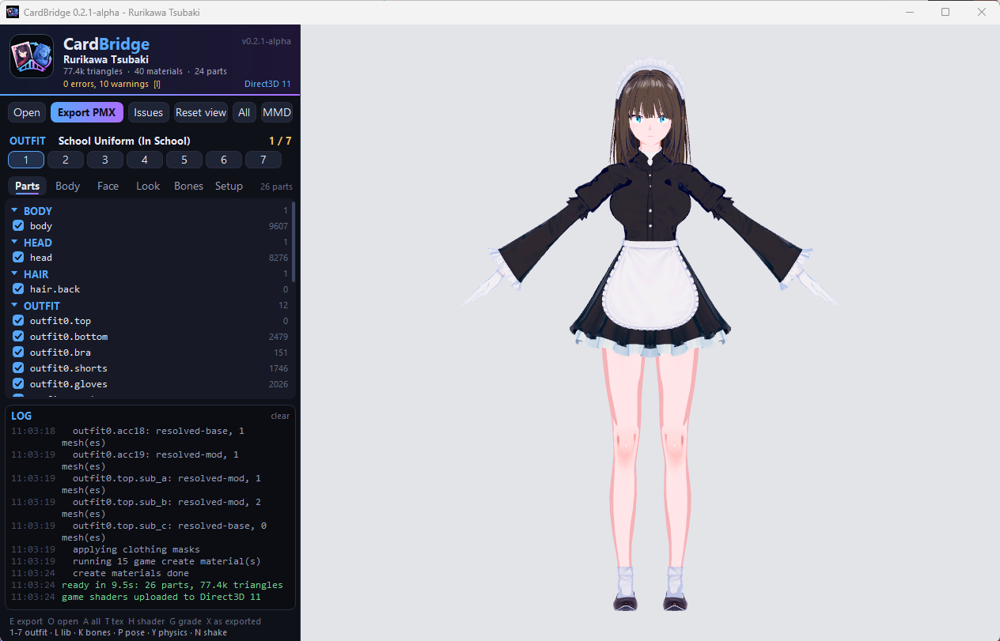
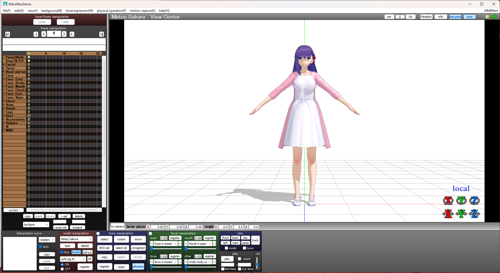
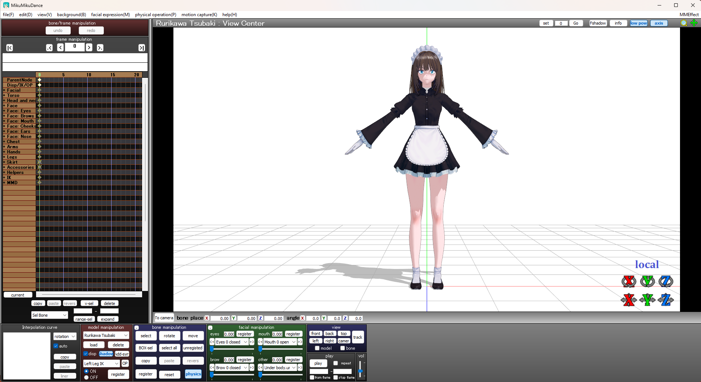

# CardBridge

[](https://hub.xerj.org/contributors/mobs3288)

<p align="center">
  
</p>

**CardBridge** converts Koikatsu character cards into rigged 3D models (PMX) with separately addressable outfit parts, entirely offline and **completely separate from the game**: it reads the card, a CardBridge asset library and the user's mod files, and needs no Koikatsu install to run. It never launches or controls the game.

It is a standalone C++ Windows application built in the same style as the Project K engine and Map Maker. Its core is a UI-free library so the Map Maker can later import its output (or call it) without a second implementation.

> **Version 0.2.1-alpha. It is usable today, but it is not finished.** It works **100% only for the base game**: cards made with the stock Koikatsu items convert and look right. **Several modded cards also work**, but not all of them, and a mod can still break a conversion or a material. It is **still in development**: expect rough edges, wrong colours on some mod items, and missing pieces (see Known limitations). Every export also writes a `_preview.png` (front, side, back) so a result can be judged without a PMX viewer, and the viewer shows exactly what the game's shaders draw. The checklist at the bottom of this file is the source of truth for what is done. The version is in the [`VERSION`](VERSION) file; `cardbridge --version` and the viewer's header show it.

## Video Demo

Watch CardBridge's converted PMX models in action in MikuMikuDance (MMD).

<p align="center">
  <a href="https://youtu.be/z1WUHVzbCjQ" target="_blank" rel="noopener noreferrer">
    
  </a>
</p>

<p align="center">
  <em>Matou Sakura – Catch Catch | Koikatsu to MMD | CardBridge</em>
</p>

## Screenshots and examples

The images below show example character cards, their appearance in CardBridge, and the exported models in MikuMikuDance.

### Character cards

| Example 1 | Example 2 |
|---|---|
|  |  |

### CardBridge

| Example 1 | Example 2 |
|---|---|
|  |  |

### MikuMikuDance

| Example 1 | Example 2 |
|---|---|
|  |  |

## Get it and run it

The release is **one exe**: `CardBridge-<version>.exe` (the viewer, with the converter and exporter inside). No installer, no scripts, no extra files.

1. Run it. The first time it asks for **your own Koikatsu folder** (the one that contains `abdata`) and copies the base-game data it needs into `%LOCALAPPDATA%\CardBridge\library` (about 0.9 GB, about 20 seconds, once). The game is never needed again.
2. It asks for your Koikatsu **mods folder** (or Cancel for base-game items only). Mods are never shipped with CardBridge: each user points it at their own.
3. Drop a card `.png` on the window. Press **E** (or *Export PMX*) to write the PMX.

**Settings.** The **Setup** tab (last tab in the panel) changes everything chosen at first run, and each change is saved at once to `%LOCALAPPDATA%\CardBridge\viewer.json`: use another library folder or build a new one from a Koikatsu folder; choose the mods folder, rebuild the mod index after adding mods, or use no mods; one fixed export folder (or ask every time); an extra folder of shader layers; open the settings folder; forget all settings. Keys `M` (mods folder) and `L` (library) still work.

`CardBridge-CLI-<version>.exe` is the same converter as a command line tool (see Usage). Every exported PMX carries the model information (CardBridge, its version and its author, Ryan Oktaviandi Susilo Wibowo, which is fixed and cannot be changed by a setting; the character; the source card) in the header comment, which MikuMikuDance shows in its model info.

## What you need

| Thing | What it is | Where it comes from |
|---|---|---|
| Windows 10 or 11, 64-bit | CardBridge is a Windows program | A graphics card with Direct3D 11 draws the viewer with the game's shaders and skins the pose on the GPU (the best-suited hardware adapter is picked by memory and capability, not vendor — see `docs/GPU_SKINNING_HARDENING.md`). Without a real GPU it uses WARP on the CPU, and without Direct3D 11 it falls back to the software renderer: slower, same pictures |

**Graphics.** The Setup tab's Graphics rows choose the device (auto picks the best-suited hardware adapter; hardware insists on one; warp and software are the CPU fallbacks) and the skin (GPU compute shader, auto — CPU for small meshes, GPU for large — or CPU loop). Changing the device takes effect at once, without restarting: the viewer recreates the Direct3D device and re-uploads the current card (and the "as exported" copy, when there is one). The header names the device actually in use. The environment variables `CARDBRIDGE_GPU` (auto/hardware/warp/software), `CARDBRIDGE_GPU_ADAPTER` (adapter index), `CARDBRIDGE_SKIN` (gpu/cpu/auto) and `CARDBRIDGE_SKIN_THRESHOLD` (auto threshold in verts) override the settings, and `cardbridge convert --gpu-view --gpu auto|hardware|warp|software --gpu-skin gpu|cpu|auto --skin-threshold N` does the same on the command line. `cardbridge skin-bench [--repeats N]` measures CPU vs GPU skinning on synthetic workloads. The Setup tab's **Export defaults** group has a "Skin shading strength" slider remembered for new cards (persisted in the viewer's own settings file, under `%LOCALAPPDATA%\CardBridge\viewer.json`): the same slider on the Look tab, applied by new loads and by the export. It defaults to 1.5 (on a 0..2 scale, higher is deeper).
| **Koikatsu or Koikatsu Party install** | The game's own data files, read **once** by the first-run setup and never again | Your own copy of the game (this is the game folder that contains `abdata`) |
| **Your mods folder** (optional) | The `.zipmod` files (Sideloader mods: hair, clothes, accessories, textures) your cards use | Your Koikatsu `mods` folder (or any folder holding the `.zipmod` files). CardBridge reads it in place and never changes it |
| **A card** | A Koikatsu character card, `.png` | Made in the Koikatsu character maker |

**What the setup copies from the game** into the CardBridge library (`%LOCALAPPDATA%\CardBridge\library`, about 0.9 GB):

- `abdata/chara/oo_base.unity3d`: the shared skeleton and the body.
- `abdata/chara/etc.unity3d`: the dummy items some mods point their empty slots at.
- `abdata/chara/*.unity3d`: every base-game hair, clothing and accessory bundle, which also hold the game's shaders (the bulk of the 0.9 GB).
- `abdata/list/characustom/*.unity3d` and `abdata/list/customshape.unity3d`: the item tables (which item id is which file) and the body and face slider shapes.
- The colour-grading table (`Lut_Amount`) from the `abdata/map/scene` bundles, so the viewer and the export use the character maker's colours.

`cardbridge library import --game <game folder> --library <folder> --minimal` copies only the first, second, fourth and fifth items (about 5 MB): base-game clothes and hair are then missing and every item has to come from mods.

**What the mods folder is for.** A card stores a mod item as the mod author's slot id plus the mod's GUID. CardBridge finds the `.zipmod` with that GUID in your mods folder and reads its meshes, textures and item list from there. If the mod is not in the folder, that item is listed as missing (by mod GUID) in the issues and the manifest, and the rest of the character still converts. The first run over a mods folder builds an index (about 15 minutes for 4,000 mods; cached in `%LOCALAPPDATA%\CardBridge\modindex.json`, so later runs are fast). Mods packed as `.rar` or `.7z` must be unpacked first.

**Not needed:** the game running, BepInEx or any plugin, Blender, MikuMikuDance (only to open the PMX afterwards). Game files and mods are never uploaded anywhere and never stay inside CardBridge's exe.

## Why this project exists

CardBridge is a tool for making anime characters for my own game, Project K, using the established Koikatsu character engine instead of Blender. I am not good at 3D modelling or texturing, and Koikatsu's character maker already does that part very well; what was missing was a reliable way to get a finished character out of it, rigged and textured, into my own engine.

It also exists to make character conversion more reliable, mod compatibility more extensible, and the entire workflow less painful.

Existing exporters run inside the running game, so a conversion needs a launched game, a working plugin set and a matching patch level, and it breaks whenever any of those drift. CardBridge reads the same data from disk instead.

<p align="center">
  
</p>

*(Humour aside: KKPMX is MIT-licensed, documents useful PMX clean-up rules, and is a reference for this project. See **Prior art** below.)*

## What it does

1. Reads a Koikatsu character card (`.png` with the card payload after the image).
2. Identifies which item IDs the card uses and which are base-game versus mod items, using the card's own Sideloader resolve data.
3. Finds the item's assets in the asset library (base-game items) or in the matching `.zipmod` under the mods folder (mod items), read-only.
4. Assembles body, head, hair, clothing slots and accessories onto the shared skeleton.
5. Writes a self-contained folder: a PMX file, PNG textures, and a `.cardbridge.json` manifest carrying the part tree, stable part IDs, per-part export inclusion, material ranges and validation status.

A Koikatsu outfit file (`【KoiKatuClothes】`, the `.png` the game saves for one coordinate) can be applied to a character **in memory only**: its clothes overwrite one outfit of the character (by default the one on screen), its accessories fill empty slots without ever deleting accessories, and the result is previewed and exported from that memory copy. The character card on disk is never saved or modified. In the viewer's Parts list the import is its own **Added outfit** group, apart from the base model's Body/Head/Hair/Outfit/Accessories: its header checkbox toggles every added part at once, each item keeps its own checkbox, the slot it overwrote is marked `*` and shown as OUTFIT (REPLACED), and `<` `>` move the import to another outfit slot. The manifest records the same split (`added_outfit` plus a `from_clothing` flag per part).

An item unticked (hidden) in the viewer's list is gone from the export the same way it is gone from the view: its meshes, its DynamicBone physics and the bones only it used are not in the PMX at all, and every exported preview picture (`_preview.png`, `_head.png`, `_feet.png`, `_view.png`, `_shaded.png`) is the viewer's picture at export time (1:1). Visible items stay in the PMX with a `Hide <part>` morph, so MMD can still hide them; the skin under a visible garment stays as the `Under`/`Nude body` morphs, not as a visible part. In the manifest this is recorded as `include_in_export: false` for the removed items.

## What it deliberately does not do

- Launch Koikatsu, automate its UI, depend on a game process, or read a game install at run time.
- Modify user files. Mods are read in place; the output contains only meshes and textures generated for the card being converted.
- Guess. Unknown card families are reported as unsupported; unresolved items are reported by mod GUID rather than silently dropped.

## Asset library: running without the game

The converter needs base-game data (the shared skeleton and body, the item list tables, and the base-game hair, clothing and accessory bundles). Instead of reading a game install, CardBridge reads its own **asset library** folder, laid out like the game's `abdata` folder:

```text
<library>/library.json            what was copied, with sizes and hashes
<library>/abdata/chara/oo_base.unity3d
<library>/abdata/list/characustom/*.unity3d
<library>/abdata/chara/*.unity3d  (full profile)
```

`cardbridge library import --game <install> --library <dir>` copies those files once. Only this command ever reads a game install. `--minimal` copies just the skeleton, body and list tables (about 5 MB); the full profile is about 0.9 GB. `cardbridge library check` verifies a library. After that, `convert` and `inspect` take `--library` and never see the game. There is no game code to copy: what the game does in its C# assembly is reimplemented in C++ here from observation and decompiled reading.

**Important:** the library holds copies of the game's data files, which belong to their authors. It is kept out of this repository (`.gitignore`). Whether a library may be redistributed to people who do not own the game is a licensing question this project does not answer. The mechanism supports "build it from your own game copy" and "ship a prepared library"; choosing the second is a legal decision for whoever distributes it.

## Supported inputs

| Family | Card marker | Status |
|---|---|---|
| Koikatsu | `【KoiKatuChara】` | Target of the first release; card and asset layers verified on real files |
| Koikatsu Party (patched) | `【KoiKatuCharaSP】` | Card container verified; asset layout assumed identical, not yet tested |
| Koikatsu Sunshine | `【KoiKatuCharaSun】` | Recognised and reported as unsupported: the container differs (4 outfits, an extra `About` block) and no Sunshine install was available to verify its asset bundles |
| Koikatsu outfit files | `【KoiKatuClothes】` (and Party/SP variants) | Supported as a clothing source: the outfit's clothes and accessories are merged into the character's in-memory outfit (see below); still rejected as a character card on its own |
| Koikatsu Sunshine outfit files | `【KoiKatuClothesSun】` | Recognised and reported as unsupported, like Sunshine characters |
| Other games, other families | others | Rejected with a specific error |

**Platform:** Windows only for now.

### Clothing files (outfit files)

An outfit file is a Koikatsu `.png` whose payload after the image is a single coordinate (the same clothes / accessories / makeup blob a character card stores per outfit) plus the same `KKEx` extended map a character carries. It never carries a face, body or hair: those always come from the character.

**Viewer.** Open a character, then drag an outfit file onto the window. It overwrites the outfit on screen in memory (the card on disk is not saved) and stays pinned to that one slot; the log says what was replaced and that hair was kept. Switching to another outfit slot shows that slot's own clothing again, and switching back shows the imported file again. The status line under the slots names the slot that holds it, and **Reset clothing** (or `D`) drops the file and returns the outfit to the card default. Dropping a different character clears the applied outfit too. Exporting (`E`) exports the merged scene, exactly as shown.

**Command line.** `convert <card.png> --clothes <outfit.png> ...` and `inspect <card.png> --clothes <outfit.png>` do the same one-shot merge for the export. `inspect <outfit.png>` shows an outfit file's name, garment ids and resolver rows. `--outfit N` chooses the target slot (default: the card's current outfit); `--replace-accessories` opts into wholesale accessory replacement.

**Hair is never deleted.** In Koikatsu the hair can live entirely in the accessory slots (a "no hair" back slot, with the hair front and back worn as accessories, categories 122/123). The merge therefore keeps every hair accessory in its slot: an empty outfit slot never clears the character, and an outfit accessory that wants a slot taken by hair moves to the first empty slot instead (its attach node still decides where it hangs). The character's hair slots (back / front / side / extension) are untouched, because an outfit file has no hair. `--replace-accessories` on the CLI is the only way to overwrite them, for users who really want it.

**How ids translate.** Outfit files store mod ids as session-local ids (the resolver rows' `LocalSlot`); character cards store the author's `Slot`. The merge translates each id through the outfit file's own resolver rows before resolving, and rewrites the rows' property paths to the target outfit (relocated accessories get their new slot index). Makeup follows the file's own enable switch: when the file does not enable its makeup, the character's makeup is kept.

**Not merged yet.** The outfit, the Sideloader resolver rows, the outfit file's KKABMX bone mods and its MaterialEditor edits are merged. Its KoiClothesOverlayX masks, HairAccessoryCustomizer settings and DynamicBoneEditor edits are still kept out (the character's are used instead).

## Reverse-engineering findings

These are facts established against real cards and the decompiled game assembly; the full evidence, with the places where it is thin, is in [`docs/OFFLINE_FORMAT_FEASIBILITY.md`](docs/OFFLINE_FORMAT_FEASIBILITY.md).

**Card container.** PNG image, then `int32 productNo`, .NET string marker, .NET string version, `int32 faceLen` + face PNG, `int32 headerLen` + MessagePack block header, `int64 dataSize`, then the blocks `Custom`, `Coordinate`, `Parameter`, `Status`, plus `KKEx` (written by the ExtendedSave plugin) and, on Sunshine, `About`. MessagePack payloads use string keys, so they decode without a schema.

**The card is references, not a model.** It stores item IDs, colours, slider values, and some embedded textures (the MaterialEditor plugin payload alone was 16 MB on the sample card). Meshes, skeleton and most textures live in Unity AssetBundles under `abdata` or inside `.zipmod` files.

**Mod resolution.** The card stores the mod author's own *slot* ID, not the session-local ID; the `KKEx` block `com.bepis.sideloader.universalautoresolver` maps each slot to a mod GUID and a property path. The zipmod's `manifest.xml` gives the GUID, and its `abdata/list/characustom/*.csv` map slot to bundle and asset name. Items without a resolve row are base game and resolve through the `ChaListData` MessagePack tables in `abdata/list/characustom/*.unity3d`.

**Assets.** UnityFS version 6, Unity 5.6.2f1. All 297 bundles in `abdata/chara` use LZ4HC (no LZMA). Meshes were uncompressed in every sampled bundle, skin weights are stored per vertex (four influences), and clothing binds to the shared skeleton by bone name. Textures seen were DXT1 and DXT5.

**Outfit structure.** Mod and base garments carry a `ChaClothesComponent` listing their renderer groups, which is the source of the part tree.

## Known limitations

- **Body proportions: applied. Face shape: not yet.** The card's 44 body slider values are turned into bone scales and offsets by the game's own formulas, which are copied into this project as generated C++ (`tools/gen_shape.py`, `src/shape/`) and applied to the skeleton, so height, bust, waist, hips and limbs follow the card. The 52 face sliders (eye size and position, jaw, nose ...) are not applied yet: the head keeps its default shape. The body shape ignores the alternative bone type (`typeBone` other than 0), which has a correction table that is not loaded.
- **Body masking.** Clothing hides body areas through mask textures; removing a garment can expose geometry that was never modelled. The tool warns; it does not invent body geometry.
- **Materials and colours.** The game's Shader Forge shaders have no PMX equivalent, so output is a diffuse-texture approximation. Done: clothing textures are baked from the list row's main texture and colour mask with the card's colours (including jacket-type tops, whose real garments are sub-parts), accessories are tinted by their colours, and eyes, eyebrows, eyelines and the nose line get their textures and colours from the card's face ids (the brow and lash shaders paint with the material's _Color, so the card's eyebrow / eyeline colour is set there, or the strokes bake white). Not done: the face (still the card's flat skin colour; the bust region of the body's skin texture is shaded automatically from the mesh's own creases, see `--skin-shade` or the Look tab; 0 disables it; the game's own body look is baked in too — a local-curvature (cavity) factor from the base body normal map (no fixed light, so it cannot fight MMD's own lighting; the game's ribs/abs/creases come out as form) plus the ink-line channel of the line mask for the card's body detailId (cf_body_00_line by default), see `--skin-ao`; 0 disables it), lips, blush and makeup layers, eye highlights, pattern textures, hair colour (hair-type accessories are recoloured to the character's hair by a plugin whose data is not decoded), shading and rim light, BC7 textures (a few face parts) and textures stored in other bundles. Items a mod ships with mismatched texture names (as in the Rin sample) keep their prefab look.
- **Export vs the preview.** The viewer runs the game's own shaders with the maker camera's colour grading and one headlight; a PMX has neither. What the export does about it: each material's shader is run over its UV layout once (colour only, lit straight from the front) and the result, passed through the same grading look-up table as the preview (`G`), is the PMX texture; the material is plain white (diffuse 1, so an engine that tints the texture by diffuse, like Project K's, shows it unchanged). Its shade comes with it as a toon ramp: the shader is also run with the light swept from straight on to behind and the result, relative to the baked colour, becomes the material's own PMX toon texture (`textures/toonN.png`, bright at the top, MikuMikuDance's and Project K's convention; the material's ambient is then white). So lighting still comes from the viewer that opens the file, but through the game's own shade curve (specular, rim and outline stay out). `--no-toon-ramp` writes the shared toon01 and the old shadow tint. Press `X` (or the `MMD` button by `All`) in the viewer to see exactly that ("as exported", the PMX as MikuMikuDance shows it: the baked textures and the materials' own toon ramps and edges, MMD's default light, its self-shadow and ground shadow, no game shader, no second grading). Every material but the face's painted layers (eyes, brows, lines) and lenses asks MMD for a ground shadow, self-shadow and an edge (draw flags 0x1E, like hand-made models; without them MMD drew no shadow at all). Transparent (alpha) materials get no ground or self-shadow (MMD drew those as a solid dark shape for a see-through garment), and a transparent garment modelled as two co-located layers (an outer and an inner surface sharing one vertex grid) gets no edge either, since MMD's edge draws back faces pushed outward and so pushed the inner layer through the outer one, covering the whole garment in the edge colour; its texture still shows. Which sides are drawn follows each shader's own Cull setting read from the bundle (the game's main shaders draw both sides, the face's layers one), and the item shader's cut-out (it discards texels with alpha below 0.25, which a MaterialEditor image uses to cut a primitive to a shape) is kept in the PMX texture instead of the cut texels showing black; a cut mesh gets no ground shadow, shadow map or edge (they would draw the whole mesh). The edge is the game's dark outline colour, or its light default applied to the texture's mean colour, at size 0.6; specular is off (MMD's broad sheen whitened skin, hair and shoes); gloss comes from sphere maps chosen from the material instead: any hair shader gets a ring highlight (add), any other non-skin surface the game gives a highlight (`_SpecularColor` x `_SpecularPower`) a soft add-gloss as strong as that highlight, and the teeth their roundness (multiply). Still different: the game's rim and outline shading, cast shadows and the face shadow mask are not in a PMX, and each viewer lights materials its own way. CLI: the baked-and-graded default, `--no-grade` to leave the grading out, `--no-toon-ramp` for the shared toon, `--bake-lit` for the old texture with the front-view shading baked in (the material is then unlit, which an engine that lights it itself shows black), `--no-bake` for the raw textures; `--gpu-view` also writes `gpu_plain.png`, the "as exported" picture.
- **Bones, expressions and physics in the PMX.** Every transform of the body and head rigs is a bone (677 on the sample cards; eyes, eyelids, brows, mouth, cheeks, chin, ears, nose included), plus the joints and chain nodes of hair, clothes and accessories. The game's bone name is the PMX name (the identity the sliders and mods use); the English field is a readable guess, driven / shape / attach nodes are written hidden, the tail points at the first child, and the bone panel is grouped (Face: Eyes, Arms, Hands, Hair, ...). The face's blend shapes become vertex morphs: one per brow / eye / mouth pattern of the game's FaceBlendShape (closed and open, in the brow / eye / mouth panels) and one per raw shape. DynamicBone chains (hair, skirts, ribbons, and the body's own jiggle chains) become a kinematic anchor, capsules and spring joints, and the body colliders become kinematic bodies. The jiggle is switchable: breast and butt jiggle are both on by default, with an intensity defaulting to 0.5 (1 = the game's own) — in the viewer these are the switches under "Jiggle (the exported PMX, and the physics preview)" on the Look tab, on the CLI `--no-jiggle-bust` / `--no-jiggle-butt` / `--jiggle-intensity F`; a part whose switch is off stays rigid, following its bone. The jiggle itself is built like the hand-made MMD models' breast jiggle (compared against a real shipped model): mode-2 bodies that follow their bones with physics on top, heavy fixed damping (0.9), no friction, fat capsules with weight tapering toward the tip (1, 1/2, 1/4, ...), and no collider at all, so the bust hit spheres cannot shove the part for ever — plus our own joint spring, which the reference models lack but which pulls the part back to its rest pose (untuned, their bare pendulum hangs displaced under gravity and wobbles like jelly). The rotation limits (the game's stiffness, ~34 degrees a link for the bust and ~17 for the butt at most, opened by the intensity, and narrow on the sway/twist axes like the reference models') are the envelope. The mapping follows the component's particle update: every chain bone (the root too) has a capsule and a spring joint at its head, damping becomes the same decay a second, elasticity the swing rate, stiffness the rotation limits; the collision mask is the Bullet filter (bit n = collides with group n), so chains meet colliders and nothing else. A test-side PMX reader and a small planar Bullet-like reference (`tests/PmxReader.h`, `tests/SpringRef.h`) check the written bodies, joints, morphs and frames and show the exported numbers settle in the time the DynamicBone sim does; gravity and force are not carried, and none of it has been opened in a real PMX editor. IK: one IK bone per arm and leg (`cb_ik_hand_L` ...; with the MMD names only the legs, because MMD solves every IK bone each frame and a motion keys no arm IK, so a handle at rest would pin the arms to the A-pose) is added after the rig's bones where the limb bones (`cf_j_arm00` / `forearm01` / `hand`, `thigh00` / `leg01` / `leg03`) form a parent chain; the elbow and knee may only flex further the way the rest pose already bends. With the MMD names the semi-standard bones of hand-made models are added around them (inserted in evaluation order, not appended): 肩P / 肩C, the twist bones 腕捩 and 手捩 (fixed axis along the limb; the game's driven skin helpers `cf_d_arm01-03`, `cf_d_forearm02`, `cf_d_wrist` take the twist in proportion to how far along the limb they sit), 腰キャンセル, 足IK親, 操作中心, 上半身1 (halfway up the back) and the tip bones 手先 and 親指先 / 人差指先 / 中指先 / 薬指先 / 小指先 (one joint length past the last joint). センター and グルーブ sit at about two thirds of the character's own pelvis height, and the foot IK turns up to 2.0 radians a pass, as on the standard models.
- **Independent outfit toggles in PMX.** PMX has no per-object visibility switch. Whether material opacity, display frames or group morphs give reliable toggles in a given viewer is untested; the manifest keeps the real toggles so the engine does not depend on viewer behaviour.
- **Plugin data.** Done: MaterialEditor main-texture replacements and KoiSkinOverlayX body, face and eye overlays, whose images are embedded in the card (they decide the look of many mod cards: the Rin sample is a blue outfit without them and the red-and-black one the card shows with them) — including the older BodyUnder/FaceUnder layout (full-coverage skin repaints drawn under the skin's own detail) and BodyOver/FaceOver (drawn on top) — and KoiClothesOverlayX garment paint. Not done: MaterialEditor colour, float and shader overrides, ABMX, DynamicBoneEditor, HairAccessoryCustomizer and similar payloads, which need their own decoders. The same applies to an outfit file's extended data: the outfit, the Sideloader rows, the outfit file's KKABMX bone mods (the skirt fit), its MaterialEditor edits (the sheer stockings) and its KoiClothesOverlayX garment paint (the blue vault suit, the Shrine Maiden's white/red overlay, the Jiangshi's mustard/pink overlay, which carry the real look where the ChaFile colours are placeholder grey or red/green/blue) are merged into the character for the target outfit; its HairAccessoryCustomizer settings and DynamicBoneEditor edits are still kept out (the character's are used instead).
- **Mods.** Only mods present on disk resolve. Duplicate GUIDs and mods shipped as unextracted `.rar`/`.7z` are not handled yet.

## MikuMikuDance compatibility and rig details

The PMX faces -Z, MikuMikuDance's front (`--unity-facing` on the CLI keeps the +Z the character is built facing). A motion (VMD) finds a model's bones and morphs by name, and MMD's standard names are Japanese, so the body bones carry them: 全ての親, センター, グルーブ, 腰, 下半身, 上半身, 上半身2, 首, 頭, 左/右 肩 腕 ひじ 手首, the finger bones (親指０-２, 人指/中指/薬指/小指 １-３), 足 ひざ 足首 つま先, 左目 / 右目 (pivot at the eyeball's centre) with 両目 above them (the eyes follow it by append rotation), 左足ＩＫ / 左つま先ＩＫ (and the right side), and the standard facial morphs with the names and panels of a hand-made MMD model: the vowels あ い う え お ん (the game's own lip-sync patterns a_l, i_l, u_l, e_l, o_l, n_l), い2 え2 お2, ワ ワ1 ワ2, ∧, ω ω□, ▲, ぺろっ, 口角上げ / 口角下げ, にやり にやり２ にやり３, ムッ, 怒った 怒った2, 口, 大口, 心配する, えー; the eyes まばたき, 笑い, ウィンク / ウィンク右 (笑い on one eye), ウィンク２ / ｳｨﾝｸ２右 (まばたき on one eye), じと目, ｷﾘｯ ｷﾘｯ2, 喜び, 慈愛; the brows 真面目, 困る, 怒り, 悲しい, 上, やっかい. Each copies the game pattern of that meaning, found by the pattern's own blend shape name, so lips, teeth, canines and the tongue (`o_tang`, kept in the mouth) move together as in the game; a head without those names gets the vowels and まばたき from its plain open mouth and closed eyes. The teeth (`cf_O_tooth`, `cf_O_canine`) come before the face in the material list: drawn after it, MikuMikuDance never showed them through the open mouth. The upper body hangs from 腰 and not from the hips, so a 下半身 turn does not carry the torso. Not there: the twist and helper bones (腕捩, 肩P ...) and the morphs the game's face has no pattern for (びっくり, はぅ, 涙, 照れ ...); a motion's keys for them find nothing and are ignored. `--no-mmd-names` keeps the rig's own names. MMD keeps the number of morphs a display frame lists in one byte and corrupts its heap from 256 on, so the Exp frame lists the first 255 morphs (outfit toggles, then the game's brow / eye / mouth patterns, then the raw per-mesh shapes); morphs beyond that stay in the file, unlisted. A physics body meets only the colliders it does not already overlap in the rest pose (a body that starts inside one is thrown out of it), no link turns more than 35 degrees, and the body's own jiggle chains (breast, hip) are left rigid (a light link carrying body skin shivers in MMD). A chain's root follows its bone and the links below it swing (a moving root shook the whole model in MMD), and a link's spring is never stiffer than 15 rad/s for its own weight, a joint that gravity would push onto its stop is locked, `--no-physics` writes no physics at all, which MMD's solver turns into a permanent shiver otherwise.

## Prior art and licensing

| Tool | Role | License |
|---|---|---|
| KKPMX | Reference for PMX clean-up rules; it runs in the game, so it cannot be a dependency | MIT |
| KKBP exporter/importer | Reference for what a full export contains; in-game plugin | Not verified |
| KKManager | Reference for card-marker detection | GPL-3.0: read for format knowledge only, no code is copied |
| UnityPy | Used for research and golden reference data only; not shipped | MIT |
| AssetRipper | Not used; noted as a reference | GPL-3.0 |
| bc7decomp (Richard Geldreich, Jr.) | BC7 texture decoder, the only third-party code in the repository (`third_party/bc7decomp`, its notice kept in the file) | MIT or public domain |
| nlohmann/json, stb_image, stb_image_write, glm | Downloaded by CMake at build time, not in the repository; glm only for the engine cross-check test | MIT; MIT or public domain; MIT |
| BepInEx | The sidecar plugin builds against the game install's copy; not in the repository | LGPL-2.1 |

Format knowledge is re-implemented from observation and the decompiled assembly; no code from the reference tools above is copied. Game and mod assets are never committed to this repository.

CardBridge's own code is released under the MIT License (see [LICENSE](LICENSE)). The licence covers this repository's code only: the game's and mods' assets, and anything converted from them, belong to their owners and are not covered by it.

## Layout

```text
cardbridge/
  CMakeLists.txt      standalone project; also add_subdirectory()-able from the engine
  src/
    core/             file IO (UTF-8 paths), LZ4, inflate, MessagePack, zip, math, SHA-256
    card/             card container and section decoding
    unity/            UnityFS bundles, serialized files, meshes, textures
    resolve/          mod index, list tables, card-to-asset resolution
    assemble/         skeleton and part assembly
    pmx/              PMX writer
    export/           output folder and manifest
    library/          asset library import and check
  cli/                command-line shell
  viewer/             the viewer window (Win32 + Direct3D 11): main.cpp (hub) + *.inc fragments grouped by tab/system, Ui.* (off-screen panel, theme), res/ (icon, logo)
  tools/              Python reference (research only, not shipped), viewer_smoke.ps1
  tests/              unit and golden tests
  image/              README artwork (CB.png is the logo)
  VERSION             the one place the version number is written
```

## Building

Windows, using the repository's portable toolchain (`tools/`):

```powershell
scripts\cardbridge.ps1
```

`scripts\cardbridge.ps1 -Test` also runs the unit tests. The build runs at idle priority. Output goes to `build-cardbridge\bin\cardbridge.exe`.

On its own (this folder as its own repository): install CMake, Ninja and a Windows C++20 compiler (MinGW-w64 or MSVC), then `build.ps1` (`-Test` runs the unit tests); output goes to `build\bin`. `package.ps1` makes the release files (`CardBridge-<version>.exe`, `CardBridge-CLI-<version>.exe`, their SHA-256) in `dist\`; the version comes from the `VERSION` file.

To check a PMX for what MikuMikuDance chokes on (nested group morphs, IK limits, NaN, bad indices): `python tools/audit_pmx_for_mmd.py model.pmx`.

## Usage

```powershell
# once: copy the needed base-game data into a library (the only command that reads a game install)
cardbridge library import --game "<game folder>" --library "<library folder>"          # add --minimal for ~5 MB
cardbridge library check  --library "<library folder>" --hashes

# look at a card: family, outfits, which items resolve to which mod
# (an outfit file alone inspects as an outfit; --clothes merges one onto the card's outfit)
cardbridge inspect "<card.png>" --library "<library folder>" --mods "<mods folder>"
cardbridge inspect "<outfit.png>"
cardbridge inspect "<card.png>" --library "<library folder>" --mods "<mods folder>" --clothes "<outfit.png>"

# convert (writes <out>\<name>.pmx, <out>\textures\*.png, <out>\<name>.cardbridge.json)
cardbridge convert "<card.png>" --library "<library folder>" --mods "<mods folder>" --out "<out folder>"
# with an outfit file applied in memory for this export only (the card on disk is never saved)
cardbridge convert "<card.png>" --library "<library folder>" --mods "<mods folder>" --clothes "<outfit.png>" --out "<out folder>"

# look at a card in a window (Windows): orbit with the left mouse button, pan with the right, zoom with the wheel.
# Hover a part row to light that part up in the model, click to hide/show it, right-click to solo it, click a group
# header to fold it. The view's top-right corner shows an always-on navigation widget (Blender-style, like the Project K
# editor): click an axis ball to look at the model from that side (drag anywhere in it to orbit as before).
# Accessory rows carry a move chip (an X/Y/Z gizmo) on their right end: click it to hold that accessory,
# then drag an axis in the view to reposition it in XYZ (the move is one pose edit: Ctrl+Z undoes it, save/load pose keeps it,
# Export PMX bakes it, and the Bones tab's numbers move with it); right-click the chip to reset the move, Esc deselects.
# The log panel shows every load/bake/export stage as it happens; E (or Export PMX) exports the
# scene currently on screen to a new folder, with the same live log. The panel shows the current outfit's number and
# name over a row of numbered slots: click a slot, press 1-7, or step with Left/Right. Other keys: T textures, H game
# shaders, G colour grading, X (or the MMD button) as exported (the PMX as MikuMikuDance shows it: toon, edge, self-shadow, ground shadow), F/S/B front/side/back, R reset, I issues, A show all, C clear log, O open, M mods folder, L library.
# Shift+Left-click any slider (the panel, the Bones tab, the Material Workbench) to type its value with the keyboard: Enter commits, Esc restores it, clicking away commits. The typed text is the stored value (percent rows: 0..100).
# The Body tab's Bust Size row carries a simple "Band:" (65..105) and "Cup:" (AA..G) preset under the slider: one click sets the size, and the chips track the slider (a size not on the grid lights none). The Look tab's Nipples group carries "Size:" (S, M, L, XL: -4 / 0 / +4 / +8 mm) under "Nipple out / in (mm)" the same way.
# Posing: K shows the skeleton over the model (click a bone to select it), the Bones tab lists the bones as a tree (helper nodes behind a switch)
# and edits the selected bone's move / rotate / scale (sliders, wheel for a fine step, right-click resets a field); the mesh follows at once, no re-assembly.
# P (or Look tab > Pose) is the automatic A-pose, on by default (MMD motions are keyed for it): clavicle and upper arm turn the arms down from the T-pose, 40 degrees by default. Export PMX writes the
# pose as the model's rest pose and lists it in the manifest's "pose". CLI: on by default, --apose-degrees N, --tpose to keep the T-pose; --gpu-view --gpu-bones draws the skeleton on the picture.
# With the skeleton on, the bone under the pointer is ringed and a click-drag on a bone turns it (Ctrl+drag moves it): the tip follows the pointer, the bone and
# everything below it (drawn in the same warm colour) swing. The body and face sliders and the nipple controls are real time too (about 6 ms: the skeleton is rebuilt
# with the game's formulas and every vertex follows through its per-bone frames, no loading), the blend shape offsets and the areola size follow too (a character whose DynamicBone chains were settled with CARDBRIDGE_DYNBONE is assembled again instead).
# The Look tab's skin shading and nipple rows are live too: "Cleavage shading" (0..2) bakes an occlusion map into the body's skin texture, limited to the bust front (a ray-cast against the character's own body, a concavity term and a soft band along the midline; the body hidden under clothing is shaded the same way so the nude body keeps its shape, and everything else keeps the card's base colour). "Koikatsu AO" (0..2, default 0.85) bakes the game's own look in as well: a local-curvature cavity factor off the base body normal map (cf_body_00_base_n; orientation-independent, darkens the creases Koikatsu paints - navel, knees, shins, joints) plus the ink-line channel of the game's line mask for the card's body detailId (cf_body_00_line at the default: clavicle, knees, navel; BetterRepack kits add a sternum line) - it complements the cleavage shading without stacking on it. "Underboob fold shading" tunes the fold at the base of the breasts independently of the cleavage (ray-gated to the fold where the breast meets the torso, so the rest of the underside stays bright); "Cleavage length" (0..2) sets how far up the breast line the cleavage shading reaches: 0 = nothing, 1 = the full breast line (top of the bust), 2 = a full bust length higher, toward the base of the neck (default 1.2); "Shading width" (0.1..2, default 0.6) sets how wide the cleavage line runs (a narrow seam to a broad gradient). The nipple colour switch and its three sliders tint the nipple and areola (on by default, a natural warm salmon-red; off gives back the card's own nipColor). CLI: --skin-shade F (cleavage), --skin-underboob F, --skin-top F, --skin-width F, --skin-ao F (the game's own look baked in: a local-curvature cavity factor off the base body normal map plus the ink-line channel of the game's line mask for the card's body detailId - cf_body_00_line at the default; the new bake yields to SkinShade's darkening where both fall on the same texel, never stacks, and defaults to 0.85; 0 restores the previous output exactly), --nipple-colour R,G,B, --card-nipples.
# Ctrl+Z / Ctrl+Y undo and redo bone edits and the A-pose (one drag or click is one step), Ctrl+S / Ctrl+O (or the buttons under the bone editor) save and load a pose as
# JSON; `--pose <file>` on the viewer loads one at start, `cardbridge convert --pose <file>` bakes it into the PMX. The software view (no Direct3D 11) shows the pose too.
# The panel is drawn off screen and only where it changed, the mouse never queues work faster than a picture can be made, and the lists scroll
# smoothly. Timing: set CARDBRIDGE_BENCH=<file.json> and open a card; the viewer plays a scripted session (orbit, hover, tabs, a slider drag, a flood of
# mouse moves, log lines, wheel), writes how long each step took from input to finished paint, and closes.
# tools/viewer_smoke.ps1 runs a private viewer on a card and takes screenshots of every tab and interaction (see its header).
# Y switches the physics preview on: the DynamicBone chains (hair, skirts, ribbons, the body's jiggle) are simulated live at 60 updates a second against the body
# colliders, so they swing as bones, sliders or the A-pose move what they hang from; N gives them a shove. The camera never pauses it.
# Drop a card .png on the window to open it, or an outfit file (.png) onto a loaded character to apply it in memory.
cardbridge_viewer "<card.png>" --library "<library folder>" --mods "<mods folder>"      # the folders are remembered
cardbridge_viewer "<card.png>" --clothes "<outfit.png>" --library "<library folder>" --mods "<mods folder>"
```

Exit codes: 0 success, 1 usage, 2 not a supported card (with the reason: not a PNG, no card data, truncated, an outfit file, unknown or unsupported family), 3 conversion failed. Items that cannot be loaded are listed with a status and reason on screen and in the manifest's `issues`; the first run over a mods folder builds an index (about 15 minutes for 4,000 mods, then cached).

Tests: `scripts\cardbridge.ps1 -Test` runs the unit tests (no game files needed). Set `CARDBRIDGE_TEST_LIBRARY`, `_MODS`, `_CARD` and `_GOLDEN` (`tests/golden/rin_reference.json`) to also run the card-to-PMX integration test, and run `cardbridge_pmx_crosscheck <model.pmx> <manifest.json>` to read a result back with the engine's PMX loader.

## FAQ

**Q: Is this vibecoding?**

> **A:** Yes.
>
> The vibes are immaculate. The vertices are under investigation.

**Q: Can you code?**

> **A:** Yes. I use AI coding tools extensively because they can implement things faster than I can write everything manually. I still make architectural decisions, review code, debug issues, and validate the results.

**Q: Then why not do it manually?**

> **A:** Because I'm too lazy to do everything manually, and Claude Opus 5.5 can often implement things faster than I can.
>
> Why spend hours writing code when I can spend those hours reviewing AI-generated code, debugging it, reverse-engineering Unity AssetBundles, and questioning every life decision that led me here?
>
> **Work smarter, not harder.** Or at least make the computer do the hard part.
> 
> And yes, when I'm not using Claude—or the budget runs out—I'll do it myself.
> — Thanos

**Q: So the AI writes everything?**

> **A:** A substantial amount of the code is AI-generated. I'm not going to pretend otherwise.
>
> I direct the implementation, make architectural decisions, investigate problems, review changes, test the results, and decide what needs fixing. AI-generated code can be wrong, inefficient, or unnecessarily complicated.
>
> If something breaks, it's still my problem.
>
> **AI-assisted development. Human-operated suffering.**

**Q: Why build this instead of just using KKPMX?**

> **A:** KKPMX already exists and is useful. CardBridge is my attempt to build an alternative with a standalone workflow, extensible mod support, better diagnostics, and eventually an integrated editing experience.
>
> These are goals, not claims that CardBridge is already better. The conversion pipeline still needs substantial validation.
>
> The objective isn't to reinvent everything just for the sake of it. It's to build something that better fits my needs.
>
> *(The meme stays, though.)*

**Q: Why Koikatsu, though?**

> **A:** Because creating anime-style characters in Koikatsu is much more accessible than building them from scratch in general-purpose 3D software.
>
> Its character creator makes it easy to customise faces, hairstyles, clothing, body proportions, and other details without needing to model everything manually. Combined with its modding ecosystem, it offers a convenient way to create and customise anime characters.
>
> The problem is getting those characters out of the game and into an editable PMX model without spending hours fixing materials, hair, accessories, and other conversion issues.
>
> That's where CardBridge comes in: bridging the gap between Koikatsu's character creation workflow and the broader MMD/PMX ecosystem.
>
> And honestly, creating anime characters is fun. Reverse-engineering Unity AssetBundles to get them out is where the suffering begins. 💀

**Q: Is CardBridge production-ready?**

> **A:** No.
>
> Milestone 1, the headless proof of concept, is complete. However, successfully generating a PMX file doesn't mean the resulting model faithfully reproduces the original character.
>
> Colours can be wrong, hair can disappear or move, materials can break, and geometry or deformation can require further work.
>
> The feasibility study suggests the approach is viable. The complete conversion pipeline still needs to prove itself through testing.

**Q: Will it support every mod?**

> **A:** That's the goal, not a promise.
>
> Mods can introduce different assets, dependencies, material configurations, and structures. CardBridge aims to handle these through extensible asset resolution, clear diagnostics, and compatibility testing.
>
> If a mod breaks the converter, I'd rather know exactly why than silently export a broken model.

**Q: Why is the project called CardBridge?**

> **A:** It bridges the gap between a character card and an editable 3D model.
>
> Also, `CardToPMXButHopefullyItActuallyWorksAndEasyToUseWithoutAnyManualModification` was too long.

**Q: Why is the logo AI-generated?**

> **A:** Because my entire budget went to Claude, and I suck at design.
>
> I'm trying to reverse-engineer Unity AssetBundles and build a standalone PMX exporter, not become a graphic designer.
>
> **Priorities, people.** 💀

## Milestones

- [x] **0.** Offline feasibility study (verdict: go)
- [x] **1.** Headless proof of concept: one real card to PMX, no game process (verified on two cards; open items in the feasibility doc, 12.4)
- [ ] **2.** Live preview and part tree on the engine renderer
- [ ] **3.** PMX part organisation, toggle testing, validation
- [ ] **4.** Standalone UI, project save/load
- [ ] **5.** Slot replacement and mod robustness
- [ ] **6.** Packaging

Milestone 1 acceptance tests (A1 to A10) are listed in the feasibility document.

---

<p align="center">
  <sub>Built with C++, reverse engineering, AI assistance, and a questionable amount of spite.</sub>
</p>
