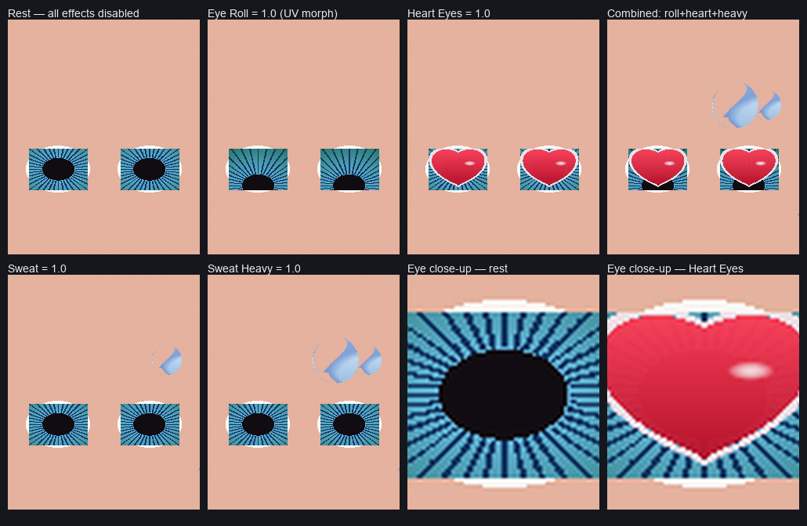

# Extended facial morph system for the PMX export — semantic names, categories and facial effects

**Status:** implemented and unit-tested (18549 checks green). Verified on synthetic scenes and on the full export path; **not yet run on a real character card with an in-game render** (no card file exists on the development machine). See "What still needs checking on a real card" at the end.

## What the exporter now writes for a face

Every facial morph is human-readable, placed on the right MMD panel, and the extended effects are embedded in the file itself — no Koikatsu, BepInEx, Unity or any other runtime plugin is needed in MikuMikuDance.

| MMD panel | What is there |
|---|---|
| Eye (目) | Eye expressions (`Eye Angry Open`, `Eye Neutral Closed`, …), the raw per-mesh eye shapes renamed (`Eye Shape A (Large) Open`), MikuMikuDance's own standard eyes (`まばたき`, `笑い`, `ウィンク`, …), the English aliases (`Eye Happy`), **`Eye Roll`**, **`Heart Eyes`** |
| Brow (眉) | Brow expressions (`Brow Serious Open`, …), renamed raw brow shapes, the standard brows (`真面目`, `困る`, `怒り`, …) |
| Mouth (口) | Mouth expressions, renamed raw mouth / teeth / tongue shapes, the standard vowels and mouth morphs (`あ い う え お ん ワ ∧ ω ▲ …`), the English vowel aliases (`Mouth Ah`, `Mouth Ee`, `Mouth Oo`, `Mouth Mm`, `Mouth Smile`) |
| Other (他) | Outfit / nude / under-piece material morphs, and **`Sweat`**, **`Sweat Heavy`** |

Plus `Mouth Ah`, `Mouth Ee`, `Mouth Oo`, `Mouth Mm`, `Mouth Smile`, `Eye Happy` as cheap group morphs that point at the standard morphs (never copies of the geometry). `Mouth FV` / `Mouth L` are **not** generated: the Koikatsu head data has no FV or L pattern, and inventing shapes was explicitly out of scope.

Every source identifier is preserved in the morph's English name (`nameEn`), e.g. `Eye Neutral Closed` (en: `Eyes 0 closed`, en for raw shapes: `cf_O_face.eye_face.f00_def_cl`), so nothing about the original data is lost and the original name is what `CARDBRIDGE_DEBUG_MORPHS=1` prints during export.

## Pipeline (all in `ExportSceneImpl`, src/export/Exporter.cpp)

1. **Source extraction** — `AddExpressionMorphs` (PmxPhysics.cpp) builds one vertex morph per FaceBlendShape pattern state from the scene's expressions, and one raw morph per blend shape (`<mesh>.<shape>`). MikuMikuDance's standard morphs are built from the same data by `AddMmdMorphs` (MmdNames.cpp) from the pattern's own blend shape key (`ex.shape`, e.g. `a_l_op`), panel-matched, with the winks cut on the rig's left/right of the face middle.
2. **English aliases** — `AddFaceAliases` (FaceMorphs.cpp) adds the six English-name group morphs, only against standard morphs that actually exist.
3. **Semantic naming** — `ApplySemanticNames` (FaceMorphs.cpp) renames the expression morphs and the raw shapes to the descriptive English names; the registry is a single table (`FaceStemLabels()`), one row per known Koikatsu face shape key. Korean / unknown keys keep an `Unknown <Panel> Morph|Shape NN` name — never a raw index and never a made-up meaning. Duplicates get ` 2`, ` 3` suffixes; the original name is kept in `nameEn`.
4. **Classification** — panels are the panels the morphs were generated with (brow/eye/mouth/other) and are unchanged; the morphs also appear in the display frames below.
5. **Extended effects** — `AddFaceEffects` (FaceMorphs.cpp) appends the overlay geometry, the overlay materials (alpha 0 at rest) and the effect morphs: `Eye Roll` (UV morph), `Heart Eyes` (material morph over two heart-pupil overlays), `Sweat` and `Sweat Heavy` (material morphs over two droplet sets). Every effect is generated independently and failure of one effect never touches the others (log line, rest of export continues).
6. **Display frames** — `FacialDisplayFrames` (FaceMorphs.cpp) adds four custom frames after the special `表情` frame: `Eye`, `Brow`, `Mouth`, `Other`, one per panel, ≤ 255 entries each (MikuMikuDance keeps the count in a byte). The Exp frame lists the first 255 morphs as before (standard morphs and the four effects are forced in ahead of the fill).
7. **Serialization** — UV morphs are PMX type 3 (verified by the independent reader in `tests/PmxReader.h`).

## The semantic registry

The name of every facial morph is derived from the blend shape key's **core word** via `FaceStemLabels()` (src/export/FaceMorphs.cpp). The key parses as: optional mesh prefix (`f00_`, `mayu00_`, `elu00_`, `ell00_`, `sL00_`, `sR00_`, `ha00_`, `t00_`), then the state marker (`_op` / `_cl` with an optional trailing set number, e.g. `bisyou_op1`), then at most one trailing capital `L`/`R` side tag, then at most one trailing set number (`ikari02` → 2), then at most one size tag (`_s`, `_ss`, `_l`). The remainder is the word.

Examples of the mapping (Japanese key → English label):

| key word | label | | key word | label |
|---|---|---|---|---|
| def | Neutral | | san | Triangle |
| egao | Smile | | niko | Smile |
| bisyou | Bashful Smile | | mogu | Mumble |
| uresi | Happy | | tabe | Eat |
| doki | Flustered | | ahe / ahe_deep / ahe_light | Ahegao / Ahegao Deep / Ahegao Light |
| ikari (02) | Angry (2) | | hyottoko | Hyottoko |
| sinken (02, 03) | Serious (2, 3) | | gag | Gag |
| keno | Disgust | | gyu / gyul / gyur / gyu02 | Squeeze / Squeeze Left / Squeeze Right / Squeeze 2 |
| sabisi | Lonely | | winkl / winkr | Wink Left / Wink Right |
| aseri | Worried | | oko | Angry |
| human | Pout | | koma / komaru | Troubled |
| akire | Exasperated | | rakutan | Dismayed |
| odoro | Surprised | | huan | Uneasy |
| doya | Grin | | tere | Shy |
| pero | Tongue Out | | setunai | Pained |
| name (02) | Lick (2) | | kurusi | Anguished |
| kuwae | Bite | | kanasi | Sad |
| kisu | Kiss | | naki | Crying |
| a i u e o n | A I U E O Mm | | sian | Pensive |
| neko | Cat | | tmara / tumara | Jito-eye |
| i_alt | I Alt | | gimo | *unmapped → `Unknown …`* |

Qualifiers compose in order: `<Eye|Brow|Mouth|Face> <Label> [Left|Right] [NN] [(Small)|(Smaller)|(Large)] [Open|Closed]`, e.g. `Brow Pensive Left Open`, `Mouth A (Large) Open`, `Eye Angry 2 Open`. Raw per-mesh shapes carry ` Shape ` in the name (`Eye Shape Neutral Closed`), expressions don't (`Eye Neutral Closed`), and every raw-shape name is unique and distinct from every expression name by construction. Vowels are sizes: `_l` = `(Large)`, `_s` = `(Small)`, `_ss` = `(Smaller)`, so `n_l_cl` → `Mouth Mm (Large) Closed`.

**The table is deliberately honest:** keys whose meaning is not documented anywhere this tool can read (`gimo`) are not mapped at all and get the `Unknown …` names. The two confidence rows worth knowing about are `gyu*` (read as ギュッ, a "squeezed shut" shape — moderate confidence) and `oko` (the childish-cute "angry" for brows — moderate confidence); both stay in the table because they are consistent across the list, but they are the first candidates to drop if the card's maker shows otherwise.

## The extended effects

All three are invisible at rest (the overlay materials are authored with `diffuse.a = 0`), are not written into any existing texture, and are bound to the head bone (sweat) or the eye bones (heart pupils), so they follow the head and the gaze like the mesh does.

### Eye Roll (`Eye Roll`, panel Eye, UV morph)
Each iris-cap vertex (`cf_Ohitomi_{L,R}02`) gets a UV offset of `(0, -0.16, 0, 0)` in the morph — the Ahegao technique expressed in PMX, where the iris samples the bottom tip of its own texture and the whites show through at the rolled edge. 0.0 = the original look; 1.0 = maximum roll; linear in between, so intermediate values work as slider values. Both eyes roll together (that is what "rolled" means). Eye white, eyeline, highlights, colours and transparency are untouched — the white material is never sampled differently. **The direction of the roll follows the exporter's stored V convention; if it rolls downward instead of upward in MikuMikuDance, flip one sign in `Eye Roll`'s UV offset (`-0.16f` → `+0.16f` in `AddFaceEffects`).** This could not be verified visually in this environment (see below).

### Heart Eyes (`Heart Eyes`, panel Eye, material morph + overlay)
Each iris cap gets a clone of itself pushed `0.0013 × scale` off the surface along its normals, with UVs remapped onto a generated heart texture (`fx_hearteyes.png`, 512², written beside the model's other textures). The overlay material starts with `alpha = 0`; the `Heart Eyes` morph adds `+1` to the alpha of that one material, fading both hearts in together. Both eyes are affected (they share the material), the iris keeps rendering underneath ("overlay" rather than "replace"), and the effect is linearly driven. No existing texture is modified and no existing material is shared.

### Sweat and Sweat Heavy (`Sweat`, `Sweat Heavy`, panel Other, material morphs + droplet overlays)
One droplet texture (`fx_sweat.png`, 128²) and two droplet sets positioned **from the face mesh's own surface, not from hardcoded indices**: the forehead anchor is the front-most face-mesh vertex above the eyes, the cheek anchors the front-most vertices to either side of the eye midline, and the heavy set is a larger forehead droplet plus two lower cheek droplets. `Sweat` fades in set A (forehead + two cheeks); `Sweat Heavy` fades in both sets, so it is visibly stronger and does not un-do `Sweat` (activate one independently, or both). Droplets are squashed UV spheres (0.42 z-squash) tangent to the surface, bound to the head bone, double-sided, specular-tinted. The skin texture is never touched and the effect disables completely at `alpha = 0`.

### Independence
The three effects own three disjoint materials and one UV channel (the iris's), touch no bone morph and no vertex morph of the face, and never overlap an outfit/nude material morph (those multiply outfit alphas; these own `face/fx_*` materials only). Enabling any subset — or all three plus every facial expression — cannot corrupt textures or materials.

### Architecture for the next effects
The same shape of solution covers the rest of the list (blush, tears, angry veins, spiral eyes, star eyes, different sweat intensities): a generated overlay or UV offset, an alpha-zero material, a material morph (or a UV morph), one line in `AddFaceEffects` to build it, one line in `FacialDisplayFrames` if it belongs to a different panel, one row in `FaceStemLabels` if it has a name. The Ahegao reference maps onto this almost mechanically: its eye-roll is the UV case above, its face-swap is the overlay case above, and its texture/material-offset technique is the `ChaShader._expression` pattern (see the next section).

## How Ahegao (IllusionMods/Ahegao) was studied and mapped

The plugin (GPL-3.0, `IllusionMods/Ahegao`) works at runtime: it sets the eye-look material's texture offset `y` down by `CfgEyeY × 2` (the iris samples lower rows of its own texture — the eye "rolls back"), forces an eye expression that carries an `_expression` (EpsTex) texture on the iris material, switches eyebrow/eyes/mouth pattern ids (`ChangeEyesPtn` etc.), and applies tears/blush through `tearsLv`/`ChangeHohoAkaRate`. It is all relative offsets and material switches at frame time.

The PMX mapping used here:

| Ahegao technique | PMX equivalent here |
|---|---|
| Eye-look texture offset biased down (Ahegao's `Roll`) | `Eye Roll` — a UV morph on the iris caps, the only permanent-bias version of the same sampling trick |
| `_expression` (EpsTex) overlay on the iris material with `_exppower` 0→1 | the heart (overlay mesh) + `Heart Eyes` material morph on `alpha` — the "expression icon on the eye" case, baked into geometry |
| `ChangeEyesPtn`-style expression pointers (`Eyes ID 25` = the ahegao eyes) | already the exporter's pattern morphs — the card's own FaceBlendShape patterns, renamed semantically here; no runtime switch needed |
| `tearsLv` / `ChangeHohoAkaRate` | not generated (no tear/blush geometry in the card data); the overlay + material-morph pattern is ready for them when a texture source exists |
| Eye expression list special-cases (spiral eyes as a `N_Gag0*` object with tile animation) | `gag` is renamed like everything else and stays a normal vertex morph; the spiral objects themselves are the card's own geometry, not generated here |

The `_expression` offset in the game is **not** carried over as a texture swap, because PMX cannot swap textures mid-morph (material morphs only offset/multiply), which is exactly why the hearts are an overlay with an alpha fade instead.

## What the exporter does not do (limitations, honest list)

*The picture above is a proof sheet rendered from the synthetic test scene's exported PMX — the "face" is a flat synthetic grid, not a Koikatsu head. It shows exactly which pixels each effect changes (the same geometry, UVs and textures MikuMikuDance will use), but it is **not** a picture of a real converted card. The real-card check is the first thing to do when this lands on a real head.*

- **Visual verification in MikuMikuDance did not happen here.** The effects were verified programmatically (morph kinds, panels, UV offsets, overlay counts, alpha-0 rest states, PMX serialization round-trip through the independent reader, display frames, texture generation). Nobody has yet opened the file in MMD. Check, in this order: `Eye Roll` rolls the right direction (flip the one sign if not), `Heart Eyes` hearts sit on both irises, `Sweat`/`Sweat Heavy` sit on the forehead/cheeks of *your* card (droplet radius is a fraction of the eye-bone spacing, so it adapts, but face proportions vary), and that disabling resets everything to the resting face.
- **Cards without the `cf_O_face` / `cf_Ohitomi_{L,R}02` renderer names** (some heavily modded eye setups) get no effects — a log line says which, the rest of the export is unaffected. The resting materials still exist, they just never fade in.
- **The iris texture needs a transparent ground with the circle inside it** (Koikatsu's `cf_Ohitomi_*` textures always have this; mod iris textures that fill the whole frame will smear at `Eye Roll` = 1 — still smooth, still bounded).
- **MMD display limits:** the Exp frame caps at 255 listed morphs as before; the four facial frames cap at 255 each. Effects are forced into Exp ahead of the fill, so they always appear there too.
- **`gimo` brow shapes are `Unknown`** (meaning not documented); `gyu*` and `oko` are moderate-confidence mappings (see the registry table); no semantic name was invented for anything unmapped.
- **No FV / L visemes** (no such patterns in the source data), and no combined "Face Angry/Sad/…" preset morphs — the cards carry no brow+eye+mouth combo list this tool can read, so generating those would be invention. The `Face *` category stays empty apart from the alias `Eye Happy`; combined presets can be added as group morphs once a real face-list source is exported from the game.
- **Sweat z-order in MMD:** the droplets draw in the transparent pass with the rest; against the face's own alpha layers they behave like any alpha overlay — if a card's face uses heavy translucent blush layers, the droplets may clip against them until drawn last. Rename the export's material draw order via the material memo if that ever shows.

## Debugging and tests

- `CARDBRIDGE_DEBUG_MORPHS=1` prints the pattern→key map and every `<old> -> <new>` rename on stderr during export.
- `CARDBRIDGE_DEBUG_EYE=1` prints the iris blend parameters (existing).
- Unit tests (in `tests/cardbridge_tests.cpp`): stem parser (prefix/state/set/size/side), expression + raw-shape renaming incl. fallbacks and uniqueness, aliases, UV morph write/read/validate, overlay generation (UV offsets, panel assignment, alpha-zero rest states, overlay vertex counts, frames), and a full synthetic `ExportScene` → `.pmx` → `pmxread` round-trip asserting semantic names, aliases, frames, effect types and unique names. `tests/PmxReader.h` was extended to read type-3 UV morphs.
- The integration suite (`CARDBRIDGE_TEST_LIBRARY` / `_MODS` / `_CARD`) is untouched and still gates the golden card run; it was skipped here (no card on this disk). Nothing about the existing export path (bones, physics, textures, outfit morphs) was modified except the display-frame insertion and the two new calls (aliases, effects) before it, and the `Exp` seeding change.

## Files

- `src/pmx/PmxWriter.{h,cpp}` — UV morph support (type 3)
- `src/export/FaceMorphs.{h,cpp}` — the whole system (registry, rename, aliases, effects, display frames)
- `src/export/Exporter.cpp` — three new calls before the frames are built; the four facial frames after `Exp`
- `tests/cardbridge_tests.cpp`, `tests/PmxReader.h` — the tests above
